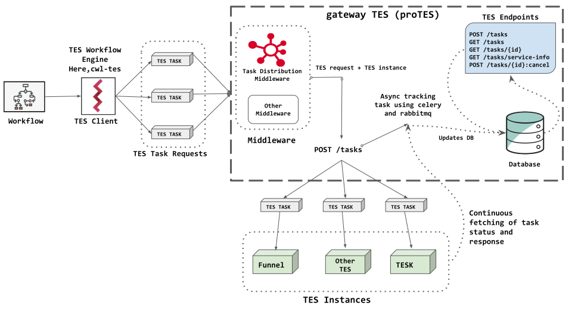

# proTES

--8<-- "README.md:synopsis"

## Known deployments

--8<-- "README.md:deployments"

## Contents

- [Getting started](getting-started.md): run proTES with Docker Compose and
  send the first requests.
- [Configuration](configuration.md): the base config, overlays, the TES
  instances, the middlewares, the task settings, the request size limit, the
  server and the service info.
- [API](api.md): the endpoints, how tasks are forwarded, and errors.
- [Middlewares](middlewares.md): the built-in middlewares, how to write your
  own, and the middleware management API.
- [Access control](access-control.md): authentication, roles, the
  permissions API and credentials of TES instances.
- [Deployment](deployment.md): the Helm chart for Kubernetes.
- [Operations](operations.md): the Celery workers, Flower and logs.
- [Upgrading](upgrading.md): changes to existing deployments and data.
- [Development](development.md): development setup, checks, documentation,
  versioning and releases.
- [Contributing](contributing.md): how to contribute, the code of conduct,
  pull requests, commit messages and the Python guidelines.
- [API reference](reference.md): the code, generated from its docstrings.
- [Changelog](changelog.md): release notes.

## Architecture

proTES provides central features to a federated network of independently
operated TES instances: it can serve, for example, as a compatibility layer,
a load balancer, a public entry point to an enclave of independent compute
nodes, or a means of collecting telemetry.

When proTES receives a task, it applies the configured
[middlewares](middlewares.md) before forwarding the task to a TES instance of
the network. A plugin system makes it easy to write middlewares for specific
requirements, such as access control, request or response processing or
validation, or the selection of suitable TES instances considering data use
restrictions and client preferences. Two middlewares are shipped with proTES,
as proofs of concept for different ways of distributing tasks (see
[Built-in middlewares](middlewares.md#built-in-middlewares)): randomly, for
load balancing, and to the TES instances closest to the task's input data, to
bring compute to the data.

proTES is a [Flask](https://flask.palletsprojects.com/) app built with
[FOCA](https://github.com/elixir-cloud-aai/foca), configured declaratively in
YAML. It stores incoming and forwarded tasks in a
[MongoDB](https://www.mongodb.com/) database. Forwarded tasks are tracked
asynchronously by [Celery](https://docs.celeryq.dev/) workers, which can be
scaled up, via a [RabbitMQ](https://www.rabbitmq.com/) broker. A
[Helm](https://helm.sh/) chart and a [Docker
Compose](https://docs.docker.com/compose/) setup are provided for
deployments on Kubernetes and for development, respectively.

## License

This project is covered by the [Apache License
2.0](https://www.apache.org/licenses/LICENSE-2.0) also [shipped with this
repository](https://github.com/elixir-cloud-aai/proTES/blob/dev/LICENSE).

## Contact

The project is a collaborative effort under the umbrella of [ELIXIR
On-Cloud](https://elixir-on.cloud/). Follow the link to get in touch with us
via chat or email. Please mention the name of this service for any inquiry,
proposal, question etc.
